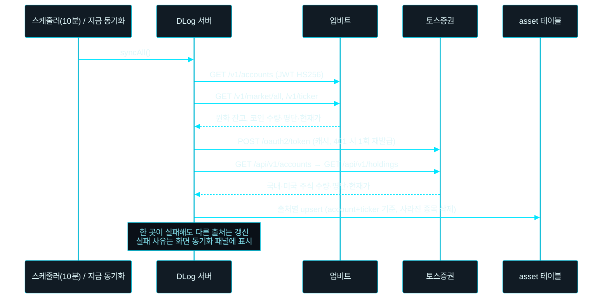

# DLog

동현의 개인 홈페이지입니다. 블로그, 작업 기록, 자산 포트폴리오를 관리합니다.

| 메뉴 | 공개 범위 |
|---|---|
| 블로그 (마크다운) | 공개 글은 누구나, 비공개 글은 관리자만 |
| 작업 기록 (프로젝트 이력 타임라인) | 누구나 조회, 수정은 관리자만 |
| 자산 포트폴리오 (통화별 평가금액·수익률·유형별 비중, 원화·달러 환산 합계, 업비트·토스증권 자동 동기화) | **관리자만** |

## 기술 스택

- **Backend**: Java 21, Spring Boot 4, Spring Data JPA, Spring Security + JWT, Flyway
- **Frontend**: React 19, TypeScript, Vite, React Router
- **DB**: PostgreSQL 16 (운영), H2 (로컬 개발)

## 구조

```
dlog/
├── backend/            Spring Boot (com.dlog)
│   ├── auth/           로그인, JWT 발급
│   ├── post/           블로그
│   ├── worklog/        작업 기록
│   ├── asset/          자산 포트폴리오
│   │   ├── sync/       업비트·토스증권 보유 자산 동기화 (upbit/, toss/)
│   │   └── fx/         원화·달러 환산용 환율 (ECB, 1시간 캐시)
│   ├── global/         보안, 예외 처리, 공통 엔티티, SPA 라우팅
│   └── resources/db/migration   Flyway 스키마
├── frontend/           React SPA
├── Dockerfile          프론트 + 백엔드를 단일 jar 이미지로 빌드
└── docker-compose.yml  운영용 PostgreSQL + app
```

## 로컬 개발

local 프로파일은 **H2 파일 DB**를 사용하므로 DB 설치 없이 바로 실행됩니다.

- 데이터 파일: `<사용자 홈>/.dlog/dlog.mv.db` (삭제하면 초기화)
- H2 콘솔: http://localhost:8080/h2-console
  - JDBC URL: `jdbc:h2:file:~/.dlog/dlog;MODE=PostgreSQL;DATABASE_TO_LOWER=TRUE;DEFAULT_NULL_ORDERING=HIGH;AUTO_SERVER=TRUE`
  - User: `sa` / Password: 없음

```bash
# 1. Backend (http://localhost:8080, 프로파일 미지정 시 local 적용 → IntelliJ 에서 DlogApplication 바로 실행 가능)
cd backend
./gradlew bootRun          # Windows: gradlew.bat bootRun

# 2. Frontend (http://localhost:5173, /api 는 8080 으로 프록시)
cd frontend
npm install
npm run dev
```

local 프로파일 기본 관리자 계정: `admin` / `dlog1234`

local 프로파일은 **자동 로그인**(`dlog.admin.auto-login=true`)이 켜져 있어 로그인 없이 관리자 화면(자산 포트폴리오, 글 작성 등)까지 모두 보입니다. 로그인 흐름을 확인하려면 환경 변수 `ADMIN_AUTO_LOGIN=false` 로 실행합니다. 운영(prod)·테스트 프로파일에서는 항상 꺼져 있습니다.

## 원화 · 달러 환산

자산 화면 상단의 **[원화 | 달러] 전환 버튼**으로 모든 금액을 선택한 통화로 환산해 봅니다. 선택값은 브라우저(localStorage)에 기억됩니다.

- **총 자산 카드**: 모든 자산을 원화로 합산한 평가금액·손익·매입금액 (달러 선택 시 달러 환산)과 **자산 유형별 비중**(원화 환산 기준). 수익률은 원화 기준
- **표의 평균단가·현재가·평가금액·손익**: 선택한 통화로 환산. 수량·수익률은 그대로
- 1 미만 금액(원화 단가의 달러 환산 등)은 소수 6자리까지 표시
- 환율을 못 가져오면 전환 버튼과 총 자산 카드 대신 **통화별 요약 카드**(각 통화 원래 금액·유형별 비중)를 보여줍니다
- 환율은 [Frankfurter](https://frankfurter.dev) 의 ECB 고시 환율(무료, 키 불필요, 영업일 갱신)을 1시간 캐시해 사용합니다. 조회에 실패하면 마지막 성공 값을 쓰고(재시도 5분 간격), 한 번도 성공하지 못했으면 환산 표기 없이 통화별 금액만 보입니다.
- 주소는 `dlog.fx.base-url` (테스트 프로파일은 외부 호출을 막기 위해 닫힌 포트로 지정)

## 자산 동기화 (업비트 · 토스증권)

자산 포트폴리오에 업비트와 토스증권의 보유 자산을 자동으로 가져옵니다. **조회 API 만 사용**하며 주문·출금 API 는 호출하지 않습니다.



| 출처 | 가져오는 자산 | 자산 유형 | 비고 |
|---|---|---|---|
| 업비트 | 원화 잔고, KRW 마켓 코인 | 현금 / 가상자산 | 주문 중(locked) 수량 포함. KRW 마켓이 없는 코인은 제외 |
| 토스증권 | 종합매매 계좌의 국내·미국 주식 | 주식 | API 가 주식·ETF 를 구분하지 않아 모두 '주식'. 예수금은 미포함 |

- 동기화된 자산은 **수정·삭제할 수 없습니다** (다음 동기화 때 덮어써지므로 서버에서 409 로 막음). 직접 입력한 자산은 그대로 유지됩니다.
- 키가 비어 있는 출처는 동기화하지 않습니다. 동기화 상태는 서버 메모리에만 있어 재시작하면 첫 동기화(30초 후) 전까지 '대기 중' 으로 보입니다.
- 주기는 `ASSET_SYNC_INTERVAL` (ISO-8601, 기본 `PT10M`).

### 키 발급

| 출처 | 발급 위치 | 주의 |
|---|---|---|
| 업비트 | 업비트 > 마이페이지 > Open API 관리 | **'자산조회' 권한만** 체크. 허용 IP 에 서버 공인 IP 등록 |
| 토스증권 | 토스증권 WTS > 설정 > Open API | 같은 화면 '허용 IP 관리' 에 서버 공인 IP 등록 (미등록 시 403). client 당 토큰 1개라 같은 키를 다른 프로그램과 동시에 쓰면 서로의 토큰이 무효화됨 |

### 키 설정

로컬은 저장소 밖 `~/.dlog/secrets.properties` (Windows: `C:\Users\<사용자>\.dlog\secrets.properties`) 를 local 프로파일이 자동으로 읽습니다. 파일을 만든 뒤 서버를 재시작하세요.

```properties
UPBIT_ACCESS_KEY=발급받은_access_key
UPBIT_SECRET_KEY=발급받은_secret_key
TOSS_CLIENT_ID=발급받은_client_id
TOSS_CLIENT_SECRET=발급받은_client_secret
```

운영(Docker)은 `.env` 의 같은 이름 변수로 넣습니다.

## 관리자 계정

1인 블로그라서 관리자 계정은 DB 대신 환경 변수로 관리합니다.

```bash
cd backend
./gradlew -q hashPassword -Ppw='내비밀번호'   # 출력된 BCrypt 해시를 ADMIN_PASSWORD_HASH 로 사용
```

## 운영 배포 (Docker)

```bash
cp .env.example .env    # 값 채우기
docker compose --profile app up -d --build
```

| 환경 변수 | 설명 |
|---|---|
| `DB_URL` / `DB_USERNAME` / `DB_PASSWORD` | PostgreSQL 접속 정보 |
| `JWT_SECRET` | 32자 이상 랜덤 문자열 |
| `JWT_EXPIRATION_MINUTES` | 토큰 만료 시간 (기본 720분) |
| `ADMIN_USERNAME` / `ADMIN_PASSWORD_HASH` | 관리자 계정 |
| `UPBIT_ACCESS_KEY` / `UPBIT_SECRET_KEY` | 업비트 자산 동기화 (선택) |
| `TOSS_CLIENT_ID` / `TOSS_CLIENT_SECRET` | 토스증권 자산 동기화 (선택) |
| `ASSET_SYNC_INTERVAL` | 자산 동기화 주기 (기본 `PT10M`) |

> `.env` 에 넣는 BCrypt 해시의 `$` 는 `$$` 로 이스케이프해야 합니다.

## 테스트

```bash
cd backend && ./gradlew test         # H2 (PostgreSQL 모드) 기반 API 테스트 + 업비트·토스 응답 형식 테스트 (로컬 가짜 서버)
cd frontend && npm run lint && npm run build
```

## API

| Method | Path | 권한 |
|---|---|---|
| POST | `/api/auth/login` | 공개 |
| GET | `/api/auth/me` | 관리자 |
| GET | `/api/posts?page=&category=`, `/api/posts/{id}` | 공개 |
| POST/PUT/DELETE | `/api/posts[/{id}]` | 관리자 |
| GET | `/api/work-logs`, `/api/work-logs/{id}` | 공개 |
| POST/PUT/DELETE | `/api/work-logs[/{id}]` | 관리자 |
| GET | `/api/assets`, `/api/assets/summary` (통화별 요약 + `total` 원화·달러 합계·유형별 비중 + `exchangeRate`), `/api/assets/{id}` | 관리자 |
| POST/PUT/DELETE | `/api/assets[/{id}]` (동기화 자산은 PUT/DELETE 시 409) | 관리자 |
| GET | `/api/assets/sync` — 출처별 마지막 동기화 상태 | 관리자 |
| POST | `/api/assets/sync` — 즉시 동기화 | 관리자 |
